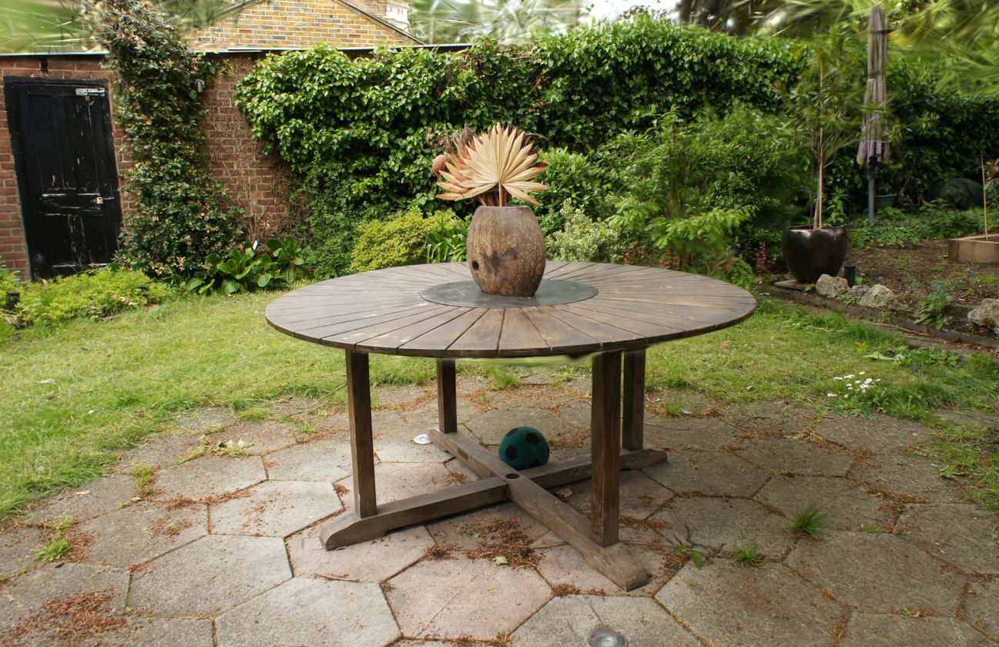
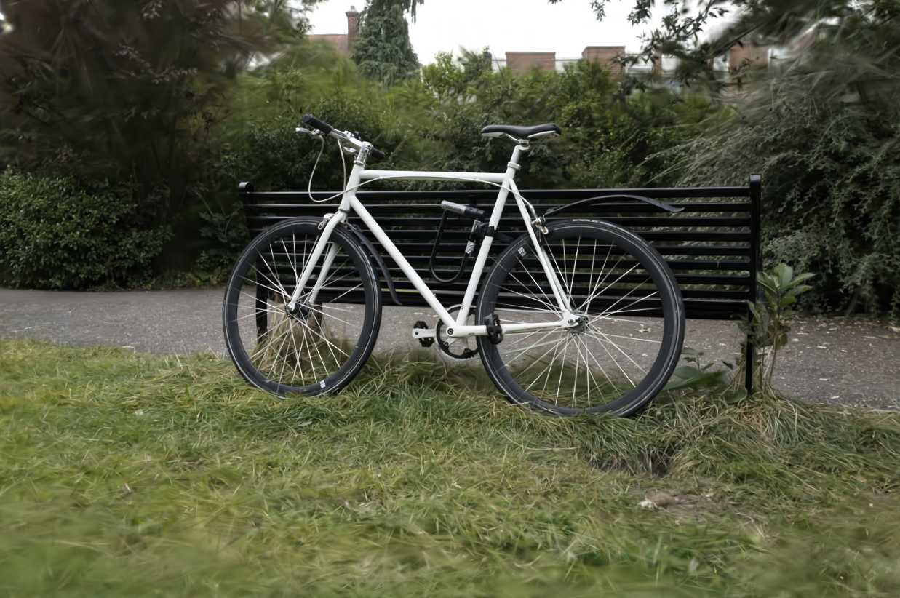

<p align="center">
  <picture>
    <source media="(prefers-color-scheme: dark)" srcset="design/banner/github-banner.png">
    <source media="(prefers-color-scheme: light)" srcset="design/wordmark/splatx-metal-lockup-light@2x.png">
    
  </picture>
</p>

# splatx-metal

3D Gaussian Splatting **training** on Apple Silicon: Metal kernels that
numerically reproduce [gsplat](https://github.com/nerfstudio-project/gsplat),
with no Python and no CUDA — plus a native macOS trainer app.


[Architecture](ARCHITECTURE.md) ·
[Kernel specs](docs/kernel-specs/00-index.md) ·
[Benchmarks](docs/BENCHMARKS.md) ·
[Contributing](CONTRIBUTING.md) ·
[Provenance](docs/provenance.md)

## Why

Every practical 3DGS training pipeline assumes a Python environment and an
NVIDIA GPU — usually a server. splatx-metal removes all three assumptions:
**the device that captured the scene can finish the training.** The whole
pipeline — COLMAP loading, EWA projection, tile rasterization, SSIM loss,
MCMC densification, Adam — runs as C++ and Metal on the Apple GPU, from a
MacBook down to an iPhone. And because it is a *numerical reproduction* of
gsplat (pinned at commit `77ab983`) rather than a reimplementation "in the
spirit of", every kernel is enforced against golden tensors generated by the
original CUDA/PyTorch implementation.

## Quick start

A 300-iteration smoke run finishes in **6–9 seconds on an M4** (dataset: any
COLMAP bundle, e.g. a [Mip-NeRF 360](https://jonbarron.info/mipnerf360/)
scene):

```sh
swift run -c release splatx train \
  --data ~/data/360_v2/garden --factor 8 \
  --iters 300 --max-points 30000 \
  --out /tmp/garden.ply --save-preview /tmp/garden_preview.png
```

Open `garden_preview.png` — that is a render of your trained model. The full
benchmark-quality run is in [Results](#results) below.

## Results

Rendered test views from full training runs on an Apple M4 (24 GB) —
garden (cap 2M, 30K iterations) and bicycle (cap 1M, 30K iterations):

<p align="center">
  
  
</p>

Quality against gsplat's published results (Mip-NeRF 360, factor 4, MCMC,
7K iterations, measured on an Apple M4, 24 GB):

| Scene | test PSNR @ 7K | gsplat published | Δ | Wall clock |
|---|---|---|---|---|
| garden (cap 2M) | 26.015 dB | 26.30 dB (N = 4.48M) | −0.285 | 14.9 min |
| bicycle (cap 1M) | 23.535 dB | 23.71 dB (N = 3.62M) | −0.175 | 8.3 min |

gsplat's published numbers use unconstrained Gaussian growth; splatx-metal
reaches parity within its acceptance gate (−0.5 dB) at 45% of the reference
splat count. At 30K iterations, garden (cap 2M) reaches 26.78 dB in 65.7
minutes on the same machine. Conditions, more results, and the exact
reproduction command for every number: **[docs/BENCHMARKS.md](docs/BENCHMARKS.md)**.

Reproduce the garden 7K row:

```sh
tools/build_metallib.sh
swift run -c release splatx train \
  --data ~/data/360_v2/garden --factor 4 \
  --mcmc --cap-max 2000000 --iters 7000 \
  --test-split 8 --eval-every 1000 --log-every 50 \
  --metallib build/splatx.metallib \
  --out /tmp/garden.spz --save-checkpoint /tmp/garden.sxck
```

The kernels, trainer, and test suite are a single code path for macOS and
iOS; the full suite and on-device training to completion have been validated
on an iPhone 15 Pro (A17 Pro).

## Features

- **Complete 3DGS training pipeline in Metal** — fused EWA projection,
  spherical harmonics (degree 0–3), tile intersection (AABB and AccuTile),
  GPU radix sort, tile-based rasterization forward/backward, fused Adam: 37
  Metal kernel entry points, every one golden-tested.
- **MCMC densification** — gsplat's MCMC strategy (relocation, capped growth,
  noise injection, opacity/scale regularization) with a preallocated
  `cap_max` arena that never reallocates during training, plus `--auto-cap`
  to derive the cap from a memory budget.
- **Device-resident training step** — the whole step is encoded GPU-side with
  only two host sync points (intersection count and loss). Steady-state 76.8
  ms/iter at N = 1M (garden); 3.7× faster per step than the host round-trip
  path under matched conditions (335 → 91 ms/iter). End to end, the garden
  7K run went from 42.5 to 8.5 minutes on an M4. The host path is kept
  permanently (`--no-resident`) as the parity oracle.
- **SSIM loss and anti-aliasing** — default loss `0.8·L1 + 0.2·(1−SSIM)`
  matching the gsplat recipe; optional Mip-Splatting 2D compensation
  (`--antialiased`), with the AA mode recorded in SPZ headers.
- **Four evaluation metrics** — PSNR, color-corrected PSNR (a port of
  gsplat's `color_correct_affine`), SSIM, and ccSSIM, reported automatically
  when a test split is held out.
- **Thermal governor** — pause-and-cool with three modes
  (`performance`/`balanced`/`lowheat`), hysteresis resume, and graceful abort
  with partial export + checkpoint when critical temperature persists.
  Thermal state is injected by the app layer, so the whole policy is
  unit-testable without heating a device.
- **Memory governor** — budget-derived `cap_max` sizing (`--auto-cap`,
  `--memory-budget-mb`) with the derivation logged.
- **Checkpoint / resume / extend** — atomic saves, config-fingerprint
  validation on resume, and ratio-based schedules so resuming or extending
  (`--extend-iters`) never collapses the learning-rate or refinement
  schedule. fp16 incremental checkpoints for mobile consumers.
- **Live training stream** — a step-boundary snapshot callback for in-memory
  live viewing (used by the trainer app) and live PLY export for file-based
  consumers.
- **SPZ export/import** — Niantic SPZ v3 output (`--out model.spz`) and a
  bidirectional `splatx convert`. On garden: 243.7 MB PLY → 21.6 MB SPZ
  (11.28×) with ~34 dB render-to-render fidelity — visually lossless for
  distribution.
- **Rendering without training** — `splatx render` renders a trained PLY
  from any COLMAP camera, and a session render C API (`sx_render_session_*`)
  drives the app's Cinema video export through the same renderer used in
  training.
- **Cinema: camera paths to video** — keyframe camera paths edited in the
  app export to HEVC/H.264 video (1080p–4K, 24/30/60 fps, BT.709); 69
  ms/frame at 1080p and 111 ms/frame at 4K (garden, 980k splats).
- **Standalone splat viewer** and **PhotogrammetrySession alignment** in the
  macOS app (below).
- **XCFramework distribution** — `ios-arm64` + `macos-arm64` static slices
  with a single C API surface, for apps that consume the trainer without
  this source tree.

## SplatX Metal Trainer (macOS app)

A project-based GUI in `apps/SplatXMetalTrainer`: import images, video, or an
existing COLMAP bundle to create a project, then walk through **Align →
Train → View/Export** — the renders in [Results](#results) are outputs of
exactly this training pipeline.

- **Align** — Apple `PhotogrammetrySession` (poses + point cloud, macOS 26
  intrinsics) writes a COLMAP text bundle; the pose conversion is validated
  against a reference COLMAP reconstruction.
- **Train** — four presets (Fast/Balanced/Quality/Ultra) over an
  always-visible options form, with a live splat view during training:
  in-memory snapshot streaming at a ~4 s cadence with flicker-free buffer
  swaps, no file polling.
- **View / Export** — orbit viewer with PLY/SPZ export. Rendering uses a
  vendored, modified fork of MetalSplatter with an exact radix depth sort
  (34.4 ms → 2.0 ms per sort at 0.5M splats, synthetic benchmark) and a
  pose-threshold resort trigger that eliminates idle-time re-sorting.
- **Cinema** — keyframe camera-path editing on a timeline with a live
  skimmer (centripetal Catmull-Rom + slerp with arc-length constant speed,
  hybrid pacing), path presets (Orbit 360°, capture trajectory), WYSIWYG
  logo overlay, and video export through the training-grade renderer.
- **Standalone viewer** — associate `.ply`/`.spz` with the app and open
  splats straight from Finder in independent viewer windows (no project
  required, multiple windows simultaneously).
- System notifications on training/alignment completion and failure.

## Getting started

### Requirements

- Apple Silicon Mac (the trainer requires a Metal GPU; there is no CPU
  training path)
- macOS 15+ with a Swift 6.2 toolchain for the CLI and runtime-compiled kernels
- macOS 26 and Xcode 26 for the app and offline `.metallib` compilation
- [xcodegen](https://github.com/yonaskolb/XcodeGen) to build the app
- A COLMAP dataset (`sparse/0` with cameras/images/points3D in `.bin` or
  `.txt`, plus `images[_N]/` folders) — e.g. the Mip-NeRF 360 scenes

### Build and test

```sh
swift build
swift run splatx-core-tests     # C++ core suite (golden-fixture validation)
swift test                      # Swift wiring tests (needs a Metal device)
```

Kernels compile through two paths — runtime source compilation and an
offline `.metallib` — and both are gated:

```sh
tools/build_metallib.sh         # → build/splatx.metallib
SPLATX_TEST_METALLIB=build/splatx.metallib swift run splatx-core-tests
```

### The `train` CLI

Highlights of the `train` surface (see `splatx train --help` for the full
list):

- `--factor {1|2|4|8}` selects `images_N/` and scales intrinsics; if the
  folder is missing, originals are downscaled at load time.
- `--mcmc` enables MCMC densification and applies gsplat's `mcmc` preset;
  `--cap-max` sizes the fixed arena, or `--auto-cap` derives it from a
  memory budget.
- `--test-split K` holds out every K-th camera (name-sorted, `i % K == 0`);
  evaluation then reports PSNR, ccPSNR, SSIM, and ccSSIM.
- `--ssim-weight λ` (default 0.2) and `--antialiased` control the loss;
  `--ssim-weight 0` is bit-identical to pure L1.
- `--resume`, `--save-checkpoint`, `--checkpoint-every`, `--extend-iters`
  for checkpointed and extended runs. Resume validates the config
  fingerprint and refuses mismatches (a differing SH degree is always
  rejected).
- `--thermal-mode {performance|balanced|lowheat}` selects the pause-and-cool
  policy. On macOS the CLI has no thermal injection source, so this is
  observational; apps inject state via `sx_thermal_set_state`.
- `--no-resident` switches to the host round-trip step (the verification
  path).

Exit codes: `0` success, `2` thermal graceful abort, `3` external stop —
`2` and `3` are **not errors**; the partial model and checkpoint are written
before exit.

### Convert, render, probe

```sh
swift run splatx convert --in /tmp/garden.ply --out /tmp/garden.spz   # PLY ↔ SPZ
swift run -c release splatx render \
  --ply /tmp/garden.ply --data ~/data/360_v2/garden \
  --factor 4 --cam 0 --out /tmp/render.png                            # no training
swift run splatx probe          # GPU capability / sustained-load probe
swift run splatx info           # build and device info
```

### Build the macOS app

The Xcode project is generated (not checked in):

```sh
cd apps/SplatXMetalTrainer
xcodegen generate
xcodebuild build -project SplatXMetalTrainer.xcodeproj -scheme SplatXMetalTrainer \
  -destination 'platform=macOS,arch=arm64' CODE_SIGNING_ALLOWED=NO
# or open SplatXMetalTrainer.xcodeproj in Xcode and Run
```

### XCFramework for external apps

```sh
tools/build_xcframework.sh      # → build/SplatX.xcframework (ios-arm64 + macos-arm64)
```

The XCFramework exposes the single C header `splatx_train_c.h`
(`sx_train_run_args`, `sx_convert_run`, `sx_render_*`, …). **Kernel
libraries are not embedded**: consumers bundle the `tools/build_metallib.sh`
output (`splatx.metallib`, or `--ios` → `splatx-ios.metallib`) and pass its
path as `metallib_path`.

## Support matrix

| Capability | macOS (Apple Silicon) | iOS / iPadOS (A17 Pro-class) |
|---|---|---|
| Training | CLI + trainer app | via the XCFramework C API, embedded in a host app |
| Kernel paths (resident / host) | both | both (same code path) |
| Full C++ test suite | gate on every change | validated on-device (iPhone 15 Pro) |
| Thermal governor | policy available; CLI has no OS injection source | host app injects state (`sx_thermal_set_state`) |
| Viewer / Cinema video export | trainer app | — |
| Kernel library | `splatx.metallib` | `splatx-ios.metallib` |
| Intel Macs / Windows / Linux | — | — |

## Architecture

```text
SplatXCore    C++ / metal-cpp — kernels, Trainer, Metal & CPU backends, IO
    │         (public headers are C++ → not importable from Swift)
SplatXTrainC  pure C API — splatx_train_c.h is the single contract surface
    │
SplatXMetal (Swift) · splatx CLI · apps/SplatXMetalTrainer
```

The C boundary is a language constraint (Swift cannot import C++ headers);
training runs as one blocking C call, and Swift observes progress through
callbacks. Kernels compile through two deliberately different paths (offline
per-file translation units and a runtime single-TU concatenation), both
gated. The CPU backend is a forward-only reference oracle, not a fallback.
The full tour — including the resident-parameter state machine, the
governor design, and the kernel-authoring rules: **[ARCHITECTURE.md](ARCHITECTURE.md)**
and [docs/kernel-specs/00-index.md](docs/kernel-specs/00-index.md).

## Verification

The correctness story is a three-stage golden-fixture pipeline:

1. **Golden generation** — deterministic-seed reference tensors produced by
   gsplat `77ab983` (PyTorch/CUDA), committed under `fixtures/` as `.sxt`
   binaries with per-fixture `meta.json` tolerances. The `meta.json` is the
   single source of truth for tolerances — tests never hardcode them, a
   missing key fails, and an empty comparison fails rather than passing
   vacuously.
2. **CPU reference** — a float32 CPU implementation of the same math is
   checked against the goldens.
3. **Metal kernels** — cross-checked against both the goldens and the CPU
   reference.

**All 212 fixture files (~2.5 MB) are committed**, so the complete numerical
regression gate runs from a clean clone with zero Python — contributors
never need PyTorch or a gsplat checkout to verify a kernel change.
Regeneration (maintainers only, for *new* fixtures) uses gsplat `77ab983`
via `tools/gen_fixtures.py`.

Fixtures are chained — the projection forward golden feeds the intersection
fixture byte-identically, which feeds rasterization, with lineage recorded
in each `meta.json`. Backward tests consume golden forward outputs rather
than live kernel outputs, so forward error cannot mask backward error.
Determinism is part of the contract: non-atomic kernels must be
bit-deterministic across runs, integer outputs must match exactly,
atomic-accumulation paths are gated by dual-run self-consistency, and the
Philox RNG is bit-identical between CPU and Metal.

Current gates: the C++ core suite (run in **both** kernel-compilation
configurations), the Swift package tests for C-boundary wiring, the macOS
app suite (including the vendored MetalSplatter fork's renderer tests), and
a resident-vs-host equivalence check.

## Limitations / non-goals

- **Apple Silicon only.** No CPU training path, no Intel Mac support, no
  Windows/Linux/CUDA — and none planned; being native is the point.
- **Toolchain split.** The CLI and runtime-compiled kernels build on macOS 15+;
  the app, offline `.metallib` compilation, and the complete release gate need
  macOS 26 with Xcode 26 (its Metal toolchain component, not the MSL version —
  `-std=metal3.2` itself is available from macOS 15).
- **gsplat is pinned at commit `77ab983`.** Newer gsplat features and
  numerics changes are adopted deliberately or not at all — the committed
  goldens define correctness, so "tracking upstream" would be a regression
  by definition.
- **Quality sits within −0.5 dB of gsplat's published 7K numbers** under
  capped splat counts (garden −0.285 dB at 45% of the reference N), not
  above them. Unconstrained-growth parity is not a goal on memory-budgeted
  devices.
- 3DGS training is memory-hungry: budget roughly 4–8 GB of unified memory
  for 1–2M splats at factor-4 Mip-NeRF 360 resolutions (see
  [docs/BENCHMARKS.md](docs/BENCHMARKS.md) for measured peaks).

## Status

Actively developed, pre-1.0: the training core and numerics are stable and
golden-gated; the app and CLI surfaces may still change between releases.

## Contributing & community

Contributions are welcome — including several kinds that need no GPU at all
(docs, COLMAP/PLY/SPZ code, benchmark reports). Start with
**[CONTRIBUTING.md](CONTRIBUTING.md)**; large features should be agreed in
an issue or in GitHub Discussions first. Look for `good first issue`
labels.

One operational note, stated plainly: day-to-day development happens in a
private repository, and this public repository is the release channel. PRs
are received, reviewed, and merged **here**, and land in the next release
snapshot (details in CONTRIBUTING.md §12).

## Provenance & licensing

3DGS implementations are a licensing minefield — AGPL forks and
unclear-provenance ports are common. This project treats **clean provenance
as a feature**: it is safe to build a commercial product on.

- Everything here is **Apache-2.0**, and every upstream this project derives
  from is Apache-2.0 (gsplat, brush, metal-cpp) or MIT (spz, MetalSplatter,
  spz-swift).
- Origin is tracked at **file granularity**: derived files carry a two-line
  derivation header, and every kernel/math file — including self-authored
  ones — has a row in the [provenance ledger](docs/provenance.md), with
  intentional deviations recorded.
- Third-party notices are consolidated in [NOTICE](NOTICE); vendored
  components keep their license texts under `ThirdParty/`.
- The contribution rules enforce the same tiers ([CONTRIBUTING.md](CONTRIBUTING.md) §6).

## Citation

If you use splatx-metal in research, please cite gsplat (whose numerics this
project reproduces) and the original 3DGS paper ([CITATION.cff](CITATION.cff)):

```bibtex
@article{ye2025gsplat,
  title   = {gsplat: An Open-Source Library for Gaussian Splatting},
  author  = {Ye, Vickie and Li, Ruilong and Kerr, Justin and Turkulainen, Matias
             and Yi, Brent and Pan, Zhuoyang and Seiskari, Otto and Ye, Jianbo
             and Hu, Jeffrey and Tancik, Matthew and Kanazawa, Angjoo},
  journal = {Journal of Machine Learning Research},
  volume  = {26},
  year    = {2025}
}

@article{kerbl3Dgaussians,
  title   = {3D Gaussian Splatting for Real-Time Radiance Field Rendering},
  author  = {Kerbl, Bernhard and Kopanas, Georgios and Leimk{\"u}hler, Thomas
             and Drettakis, George},
  journal = {ACM Transactions on Graphics},
  volume  = {42},
  number  = {4},
  year    = {2023}
}
```

## Acknowledgements

- **[gsplat](https://github.com/nerfstudio-project/gsplat)** (Apache-2.0) —
  the numerical reference for this project. The Metal kernels and training
  strategy (including MCMC densification) are derived from gsplat's CUDA
  and PyTorch implementations at commit `77ab983`, reimplemented for
  Metal/C++.
- **[brush](https://github.com/ArthurBrussee/brush)** (Apache-2.0) — the GPU
  radix sort kernels are derived from brush's `brush-sort` crate at commit
  `3b80985` (FidelityFX Parallel Sort lineage), reimplemented in Metal
  Shading Language.
- **[metal-cpp](https://github.com/apple/metal-cpp)** (Apache-2.0) — Apple's
  C++ interface for Metal, vendored unmodified under `ThirdParty/metal-cpp`.
- **[spz](https://github.com/nianticlabs/spz)** (MIT) — Niantic Labs' SPZ
  format library, vendored at v2.1.0 under `ThirdParty/spz`. The SPZ splat
  format is by Niantic Labs.
- **[MetalSplatter](https://github.com/scier/MetalSplatter)** (MIT) — Sean
  Cier's Metal splat renderer, vendored under `ThirdParty/MetalSplatter` as
  a modified fork of release 1.0.1 (depth sort replaced with an exact radix
  sort, pose-threshold resort trigger; the full deviation list is in
  [ThirdParty/MetalSplatter/VERSION.txt](ThirdParty/MetalSplatter/VERSION.txt)).
  Its dependency [spz-swift](https://github.com/scier/spz-swift) (MIT) is
  consumed via Swift Package Manager.

## About POSTMEDIA

splatx-metal is built and maintained by **POSTMEDIA**, a Korean software
company building on-device 3D capture and reconstruction products on Apple
platforms. This framework is the training engine behind our capture apps —
published so the Apple-native 3DGS ecosystem has a commercially safe
foundation to build on.

- [postmedia.ai](https://postmedia.ai) · [splatx.postmedia.ai](https://splatx.postmedia.ai)

The SplatX name, the SplatX Metal wordmark, and the POSTMEDIA name and logo
are trademarks of POSTMEDIA. The Apache-2.0 license covers the code; it does
not grant rights to use these marks (see LICENSE §6). The brand assets under
`design/` are included for building the app from source, not for reuse in
other projects.
